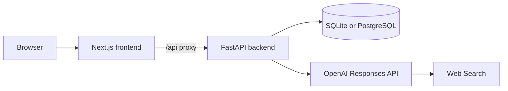

# Idea Atelier

**Turn a rough project idea into a researched, costed, and traceable build plan — one approved stage at a time.**

Idea Atelier is a human-in-the-loop planning workspace. It researches whether your idea already exists, helps you decide whether to go ahead, and then produces a scoped function plan, a clickable prototype, and an architecture, all linked by traceable requirement IDs. Every version is kept, and the finished plan exports as a ZIP.

🌐 **Live beta:** [idea-atelier-web.onrender.com](https://idea-atelier-web.onrender.com). Sign-up is invite-only; contact the repository owner for an invite code.

> Hosted on Render's free tier: after a period of inactivity, the first visit shows a "Waking up the server" screen for about a minute.

## The five stages

| # | Stage | Output |
| --- | --- | --- |
| 1 | **Idea brief** | Problem, target users, constraints, assumptions, success criteria |
| 2 | **Research & decision** | Live web research on comparable products and resources, with cited sources, and a `GO` / `PIVOT` / `STOP` recommendation |
| 3 | **Function plan** | Functions with IDs, MVP / Standard / Stretch scope, dependencies, effort and cost ranges |
| 4 | **Interactive prototype** | Browser-based HTML prototype with mocked behaviour clearly marked |
| 5 | **Architecture** | Components, data flow, integrations, deployment, security, trade-offs, and cost, mapped back to the function IDs |

Each stage can be generated, revised with feedback, and must be explicitly accepted before the next one unlocks. You make the decision after research: `PIVOT` restarts with a revised idea, and `STOP` closes the project. Editing an earlier stage marks the later stages as out of date, without deleting their history.

## How the AI works

The model doesn't run as an autonomous agent; the backend controls every step.

- **Web-grounded research.** The research stage requires the model to use OpenAI's web search tool. The backend collects the source URLs from the actual search results, and it rejects a report if a link isn't one of those sources. Queries, sources, citations, and timestamps are saved with the report.
- **Strict structured output.** Every stage must match a strict JSON format, and the backend then checks it: estimates must be consistent, dependencies must make sense, and every function ID must trace from the plan through the prototype and the architecture.
- **Human approval at every stage.** Nothing moves forward until the user accepts it.
- **Untrusted input.** User ideas and retrieved web pages are treated as data, not as instructions.
- **Demo mode.** It runs the full workflow with fixed sample content and no API calls, so you can try it without an API key.

It doesn't use RAG (no embeddings or vector store) or an agent framework such as LangGraph.

## Highlights

- Next.js + TypeScript frontend; FastAPI + Pydantic backend
- SQLite locally, PostgreSQL in production, Alembic migrations
- Invite-only accounts, hashed passwords, HttpOnly session cookies, per-user project isolation
- Configurable daily live-generation quota per account
- Background generation with protection against concurrent runs and recovery after a restart
- Renders Markdown, tables, Mermaid diagrams, and sandboxed HTML prototypes
- ZIP export: current artifacts, full version history, sources, CSV estimates, prototype HTML, Mermaid source

## Architecture



The browser only talks to the Next.js server, which forwards `/api/*` requests to FastAPI, so login cookies stay on the site's own domain. The backend owns all model calls and database access; the OpenAI API key never reaches the browser and is never stored in the database.

## Technology stack

| Layer | Technology |
| --- | --- |
| Frontend | Next.js 15, React 19, TypeScript, Mermaid |
| Backend | FastAPI, Pydantic, SQLAlchemy, Alembic |
| AI | OpenAI Responses API, Web Search, Structured Outputs |
| Local database | SQLite |
| Production database | PostgreSQL |
| Deployment | Render Blueprint |
| Testing | Pytest, Next.js production build, TypeScript |

## Repository layout

```text
.
├── frontend/          Next.js App Router frontend (TypeScript)
├── backend/
│   ├── app/           FastAPI application and five-stage workflow
│   ├── migrations/    Alembic database migrations
│   └── tests/         Auth, provider, and workflow tests
├── docs/
│   ├── architecture.md   Implemented workflow, code map, and current boundaries
│   └── validation.md     Verification record
├── legacy/
│   └── v1-codex-agent/   Original V1 prompt-based Codex workflow (archived)
├── setup.ps1          Windows dependency setup
├── start.ps1          Windows development launcher
├── .env.example       Local configuration template
└── render.yaml        Render deployment blueprint
```

## Run locally on Windows

Requirements:

- Python 3.11 or newer
- Node.js 20.9 or newer
- pnpm

From PowerShell:

```powershell
./setup.ps1
Copy-Item .env.example .env
./start.ps1
```

Open [http://127.0.0.1:3000](http://127.0.0.1:3000). The local backend runs at `http://127.0.0.1:8000`, with interactive API documentation at `http://127.0.0.1:8000/docs`.

Demo mode works without an OpenAI API key. To use Live mode, add a valid key to `.env` and restart the application.

## Run locally on macOS or Linux

Start the backend:

```bash
python -m venv .venv
source .venv/bin/activate
python -m pip install -r backend/requirements.lock.txt
cd backend
python -m uvicorn app.main:app --host 127.0.0.1 --port 8000
```

Start the frontend in another terminal:

```bash
cd frontend
pnpm install --frozen-lockfile
pnpm dev
```

## Environment variables

Copy [`.env.example`](.env.example) to `.env` for local development. Never commit real secrets.

| Variable | Purpose | Local default |
| --- | --- | --- |
| `OPENAI_API_KEY` | Enables Live generation and Web Search | Empty |
| `OPENAI_MODEL` | Responses API model | `gpt-5.5` |
| `DATABASE_PATH` | Local SQLite file | `data/brainstorm.db` |
| `DATABASE_URL` | PostgreSQL connection string; overrides `DATABASE_PATH` | Empty |
| `AUTH_REQUIRED` | Requires account authentication | `false` |
| `ALLOW_SIGNUPS` | Enables registration | `true` |
| `INVITE_CODE` | Required registration code when production signups are enabled | Empty |
| `COOKIE_SECURE` | Sends session cookies over HTTPS only | `false` |
| `SESSION_DAYS` | Session lifetime in days | `30` |
| `DAILY_GENERATION_LIMIT` | Per-account daily Live requests; `0` disables the limit | `0` |
| `CORS_ORIGINS` | Comma-separated allowed browser origins | Local origins |
| `TRUSTED_HOSTS` | Comma-separated accepted hostnames | Local hosts |
| `API_ORIGIN` | Backend URL used by the Next.js API proxy | `http://127.0.0.1:8000` |

Production secrets belong in Render's **Environment** settings. The repository intentionally excludes `.env`, `.env.local`, local databases, dependency folders, and build output.

## Deploy on Render

The root [`render.yaml`](render.yaml) provisions two web services:

- `idea-atelier-web` — Next.js frontend
- `idea-atelier-api` — FastAPI backend

Create PostgreSQL separately in the same region and set the API service's `DATABASE_URL` to its Internal Database URL. The database is managed separately so Blueprint syncs preserve the manually configured connection after database replacement. Never commit database credentials.

Deployment steps:

1. Fork or push this repository to GitHub.
2. Create a Render Blueprint from `render.yaml`.
3. Enter `DATABASE_URL`, `OPENAI_API_KEY` and a long random `INVITE_CODE` when prompted.
4. Let Render create and deploy both web services.
5. Open the frontend URL and register through **Have an invite? Create an account**.

The Blueprint runs Alembic migrations when the API starts, enables secure authentication cookies, and sets a default limit of 20 Live generations per account per UTC day. For an existing service, set `DATABASE_URL` manually in Render Environment; subsequent Blueprint syncs leave it unchanged (`sync: false`).

Render's free web services sleep after inactivity; the frontend shows a "Waking up the server" screen and wakes the backend in parallel, so the first visit takes about a minute. Free Render PostgreSQL databases also have a limited lifetime, so upgrade or migrate the database before it expires if the stored accounts and projects must be retained.

## Validation

Run the backend suite from `backend`:

```powershell
../.venv/Scripts/python.exe -m pytest -q
```

Run frontend checks from `frontend`:

```bash
pnpm typecheck
pnpm build
```

Current verification: **16 backend tests pass**, the TypeScript check passes, and the Next.js production build completes successfully. See [`docs/validation.md`](docs/validation.md) for tested scenarios and known boundaries.

## Security notes

- Keep `OPENAI_API_KEY`, `INVITE_CODE`, database credentials, and `.env` files out of Git.
- Live generation consumes OpenAI API credits; failed requests are not automatically retried.
- Password reset, email verification, billing, admin screens, distributed workers, penetration testing, and load testing are outside the current beta scope.
- Generated prototype code is sandboxed inside the app. Review exported HTML before opening or publishing it independently.

## Project history

- **V2 (current):** the deployable Next.js and FastAPI application in this repository. Implementation details are in [`docs/architecture.md`](docs/architecture.md).
- **V1 (archived):** the original prompt-based Codex workflow that defined the five-stage method. It is kept for reference in [`legacy/v1-codex-agent/`](legacy/v1-codex-agent/README.md).

## License

No open-source license has been added. All rights are reserved by the repository owner unless a license is added later.
